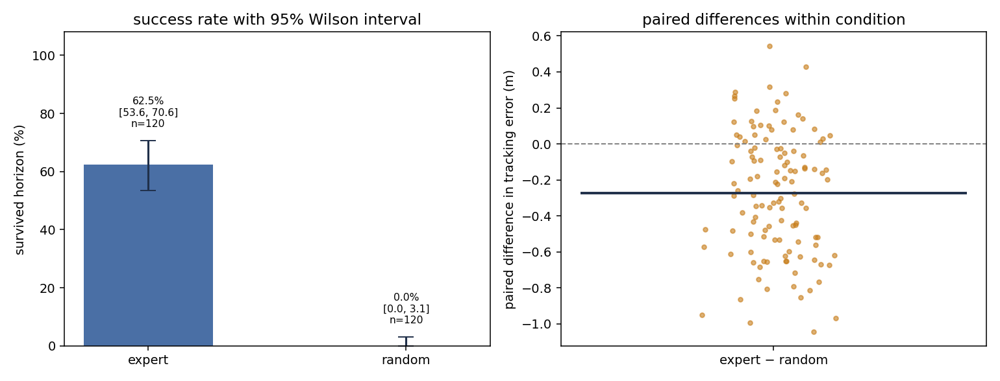

<div align="center">

# OpenBot-Sim · statistics

**Statistical design and evaluation of a vision-based imitation-learning policy.**

Same simulator as [openbot-sim](https://github.com/LuC-lis/openbot-sim), read
through a statistical lens. The project began with a shortcut-learning failure
— a policy that aced closed-loop recovery without using its camera — and is
organised here as a designed experiment: conditions sampled by Latin hypercube,
outcomes reported with interval estimates, comparisons made on paired seeds, and
the failure modes fitted rather than summarised.

[](#)
[](#reproduce-it)
[](LICENSE)



<sub>Left: survival rate with its 95 % Wilson interval. Right: per-episode paired
differences in tracking error against the baseline. Both regenerate from the
logged episodes with one command.</sub>

</div>

---

## The question, stated so it can be falsified

> **Does the learned policy use its camera, and what makes it fail?**

The first half of that question is a claim about a *mechanism*, and it is easy to
state it so loosely that no result could contradict it. This repository states it
as a null hypothesis instead:

> **H₀** — the policy's commanded turn does not depend on the camera image.

Under H₀, substituting a noise image for the real one within a condition leaves
the steering span unchanged, and the paired differences are exchangeable. The
test is a paired permutation test, so the p-value needs no distributional
assumption and is exactly reproducible
([`statistics/tests.py`](statistics/tests.py),
[`experiments/probe_permutation.py`](experiments/probe_permutation.py)).

The second half — *what makes it fail* — is not answerable by a success rate, so
it is fitted: a logistic regression of the failure indicator on the condition
factors, with Wald standard errors and odds ratios
([`statistics/regression.py`](statistics/regression.py)).

---

## Key results

Two kinds of number appear below, and they are kept apart deliberately:

**(a) Analysis layer — reproduced from the committed episodes.**
`results/outcomes_design.csv` holds 240 logged episodes (2 policies × 40
conditions × 3 replicates, 400-step horizon). Every interval below is recomputed
from that file by `python -m statistics.analyze`.

| Result | Value | Where it comes from |
|---|---|---|
| Privileged expert survives the horizon | **62.5 %** (75/120), 95 % Wilson CI **[53.6 %, 70.6 %]** | [`results/report_design.md`](results/report_design.md) |
| Random-walk baseline | **0 %** (0/120), 95 % Wilson CI **[0 %, 3.1 %]** | same |
| Paired difference (expert − random), same conditions and seeds | **+62.5 pp** [53.3, 71.7], permutation p = **0.001** | same |
| Paired difference in tracking error | **−0.275 m** [−0.335, −0.216] | same |
| Expert failures are **all collisions** (45/120); off-road 0, spin-out 0 | condition factors do **not** significantly predict failure (all p ≥ 0.15) | logistic fit, n = 120 |
| Every factor is perfectly stratified in the design | one point per stratum, per factor, per replicate | [`results/design_coverage.png`](results/design_coverage.png) |
| What the design could have detected | **16.4 pp** on the success rate, **dz = 0.256** on paired tracking error, at 80 % power | [`statistics/power.py`](statistics/power.py) |

The null result in the last row is reported as a null result: with 120 episodes
and 45 events the model can rule out strong effects of the starting pose, the
obstacle position and the disturbance rate, and nothing more.

**(b) Recorded runs of the learner — from the earlier diagnostic study.**
These are single-run numbers from the training pipeline in this repository
(`models/dg_s3.tflite`, `results/dropout_sweep.png`,
`results/dagger_progress.png`); they are not re-derived by the analysis CLI.

| Finding | Evidence |
|---|---|
| The default policy architecture silently ignores its camera and regresses to open-loop control | [`experiments/probe_ablation.py`](experiments/probe_ablation.py) |
| Root cause isolated to **dropout**, with a cliff between p = 0.4 and p = 0.5, read by effect size against a noise-image control | [`results/dropout_sweep.png`](results/dropout_sweep.png) |
| **DAgger** raises closed-loop recovery from **20 % → 100 %** over three rounds | [`results/dagger_progress.png`](results/dagger_progress.png) |
| GPU workflow: peak memory **8.4 GB → 1.9 GB** | [`scripts/train.py`](scripts/train.py) |

---

## What makes it a *designed* experiment

| Design decision | Why |
|---|---|
| **Latin hypercube** over six factors (initial pose, heading, command, obstacle placement, appearance seed, disturbance rate) | 40 conditions cover every factor's range evenly instead of clumping; see [`results/design_coverage.png`](results/design_coverage.png) |
| **Identical episode seeds for every policy** | the comparison is *paired*, so the between-condition spread cancels instead of inflating the interval |
| **Explicit appearance randomisation** (floor texture, illumination, colour temperature, vignetting, sensor noise) | a success rate should be an estimate over scenes, not over one remembered scene |
| **Obstacles as geometry, not decoration** | a blocked lane forces a decision lane-keeping never has to make; it produced 100 % of the expert's failures |
| **Failure modes kept separate** in the log (`off_road`, `turned`, `collision`) | "failed" is not a finding |
| **Wilson** intervals rather than Wald | policies sit at 0 % and 100 %, where the normal approximation is simply wrong |
| **Permutation** tests rather than t-tests | the exchangeability assumption is written down and checked, not assumed |
| **A-priori power analysis** (77 episodes per policy for 62.5 % vs 40 % at 80 % power; 120 run) | the sample size is chosen before the data, and the minimum detectable effect is quoted next to it afterwards |

Full protocol, including what this analysis cannot tell you:
[`docs/statistical_protocol.md`](docs/statistical_protocol.md).

---

## Reproduce it

```bash
git clone https://github.com/LuC-lis/openbot-sim-statistics && cd openbot-sim-statistics
pip install -r requirements.txt

python -m tests.test_statistics                                  # 12/12, ~10 s
python -m statistics.evaluate_design --out results/outcomes_design.csv   # ~3 min, CPU only
python -m statistics.analyze results/outcomes_design.csv --report results/report_design.md \
        --figure results/design_summary.png
```

`evaluate_design` runs the two baselines; add `--model models/student.tflite` to
put a learned policy on exactly the same conditions and seeds.

```bash
# the input-blindness hypothesis, as a test (needs TensorFlow for the .tflite policy)
python experiments/probe_permutation.py --model models/dg_s3.tflite --json results/permutation_test.json
```

---

## Repository layout

```
statistics/            the analysis layer — numpy only, no SciPy, no TensorFlow
  design.py              Latin hypercube + paired seed sets + factor ranges
  outcomes.py            run a policy over the design, log one row per episode
  intervals.py           Wilson score interval, bootstrap, paired bootstrap
  tests.py               permutation tests; the input-blindness hypothesis
  regression.py          logistic regression (IRLS) + Wald SEs + odds ratios
  power.py               a-priori sample size + minimum detectable effect
  analyze.py             CLI: outcomes CSV -> interval table, model table, markdown
  evaluate_design.py     CLI: run the design and write the outcomes CSV

experiments/           the diagnostic study
  probe_dropout.py       dropout sweep (recorded: cliff between 0.4 and 0.5)
  probe_ablation.py      component ablations (dropout vs. BN vs. cmd-concat)
  probe_lateral.py       image -> lateral-offset probe
  probe_inmem.py         in-memory data control
  probe_permutation.py   input-blindness as a paired permutation test

openbot_sim/           the simulator (from scratch: dynamics, camera, world, task)
  appearance.py          floor texture / illumination / noise randomisation
  world.py               road geometry + rectangular obstacles
  camera.py              forward pinhole camera + ground-plane ray casting
scripts/               data export, DAgger, training, evaluation, TFLite tools
tests/test_statistics.py   unit tests for the analysis layer
docs/statistical_protocol.md
results/               figures + the committed outcomes CSV and report
```

---

## The simulator, briefly

The environment is written from scratch — vehicle dynamics, camera, world, task
and a Gym-style loop — with the observation/action interface matched exactly to
the real OpenBot Android stack, so a `.tflite` trained here is drop-in
compatible with the phone app.

| Quantity | Specification | Source in OpenBot |
|----------|---------------|-------------------|
| Image | `(96, 256, 3)` float32 in `[0, 1]` | `Autopilot.java`, `assets/config.json` |
| Command `cmd` | scalar in `{-1, 0, +1}` | `Autopilot.java`, `utils/Enums.java` |
| Action | `[left, right] ∈ [-1, 1]` | `vehicle/Control.java` |

---

## Environment notes

- **CPU only** for the analysis layer and the demos: `numpy`, `matplotlib`, `Pillow`.
- **TensorFlow** (`>= 2.9`) only for training, `.tflite` inference and
  `experiments/probe_permutation.py`. TF 2.15.1 needs CUDA 12.2 / cuDNN 8.9;
  if CUDA comes from the pip `nvidia-*-cu12` wheels, run through
  `scripts/cuda_run.sh` so TensorFlow can find them.

## Attribution

The interface contract and network architecture follow
[OpenBot](https://github.com/ob-f/OpenBot) (Müller & Koltun, *OpenBot: Turning
Smartphones into Robots*, ICRA 2021, Apache-2.0). `openbot_sim/nets.py` is a
minimal re-implementation, so this repository has no dependency on the OpenBot
source tree.

## License

MIT — see [LICENSE](LICENSE).
